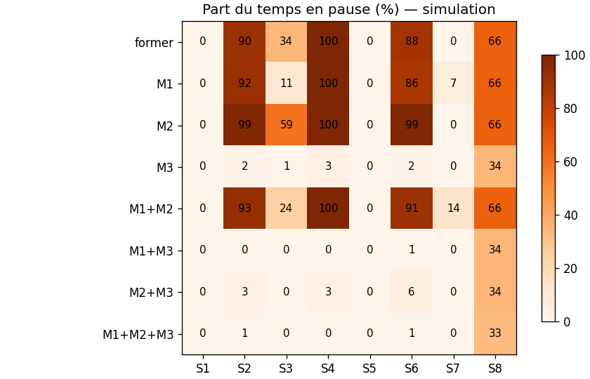
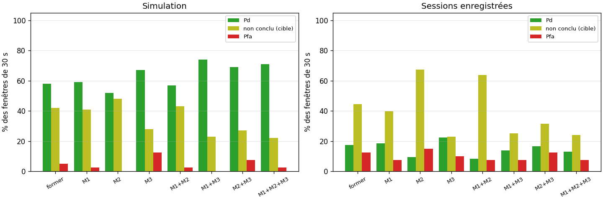
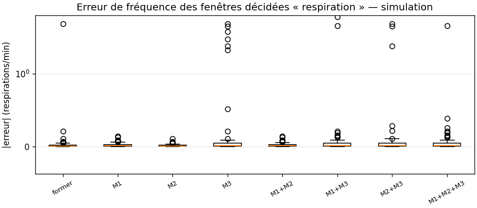
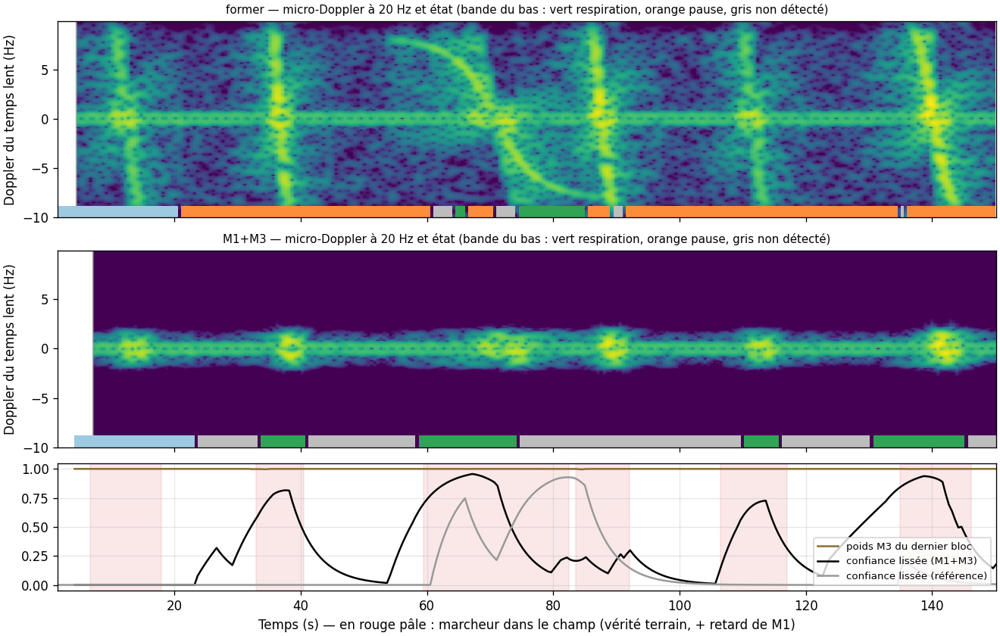

# Évaluation de la robustesse aux mouvements parasites (SISO)

Conception : [`MOTION_ROBUSTNESS_PLAN.md`](MOTION_ROBUSTNESS_PLAN.md).

Résultats produits par :

```bash
python scripts/evaluate_motion_robustness.py --midpoints-db 0 3 6 9 12
```

Les résultats bruts sont dans `results/motion_robustness/` : `results.json` et `summary.md`.

## En bref

Configuration retenue par défaut : **M1 + M3** (M2 désactivé, κ₀ = 9 dB).

| | Ancienne chaîne | M1 + M3 |
|---|---|---|
| Pause, scènes avec perturbateurs (S2 à S7) | 34 à 100 % | 0 à 1 % |
| Pd (fenêtres de 30 s, cible présente) | 58 % | **74 %** |
| Pfa (pièce vide) | 5 % | **0 %** |
| Fenêtres non conclues, cible présente | 42 % | 23 % |
| Erreur de fréquence, médiane / P95 | 0,01 / 0,07 /min | 0,02 / 0,16 /min |
| Cible qui bouge : fenêtres non conclues | 100 % | 100 % |
| Sessions enregistrées : pause / Pfa | 57 % / 12 % | 1 % / 7 % |

- **Les passants ne mettent plus la mesure en pause.** Un marcheur qui coupe le faisceau à 3 m laissait 5 % des fenêtres conclure à une respiration ; il en laisse maintenant 70 %.
- **Le mouvement de la cible elle-même met toujours en pause** (34 % du temps dans S8), et toutes les fenêtres où elle bouge restent non concluantes.
- **Il faut M1 et M3 ensemble.**
  - M1 seul retire les perturbateurs hors bande, mais pas les pauses dues aux passages par vitesse radiale nulle.
  - M3 seul supprime les pauses, mais laisse les perturbateurs atteindre la démodulation : Pfa de 12 %, erreur P95 de 3 /min.
- **M2 n'apporte rien dans ces scènes** (Pd 71 % pour M1+M2+M3 contre 74 %, Pfa 2 % contre 0 %). Il est désactivé par défaut.
- **Limite d'une seule antenne :** une personne qui se balance à 2 m, avec un écho trois fois plus fort que celui de la cible et des mouvements dans la bande respiratoire, ne peut pas être séparée de la cible (S4 : Pd 0 % pour toutes les configurations).

## Protocole

- **Configurations :**
  - l'ancienne chaîne (`former`), qui met en pause sur tout déplacement de plus de 30 mm ;
  - les combinaisons de M1, M2 et M3 ;
  - toutes avec le même mode mesure (M4).
- **Simulation :**
  - porteuse 2,45 GHz ;
  - cible à 3 m qui respire à 12–24 /min, 5–10 mm crête à crête ;
  - deux murs (réflecteurs statiques), que les passants masquent ;
  - 5 graines × 150 s par scène, à 20 kS/s (même décimation à partir de 100 Hz).
- **Sessions :**
  - les 69 anciennes sessions : 54 `breathing`, 15 `empty`, 2 kHz, 3,5 GHz, IQ déjà décimé par l'ancien système ;
  - aucune chaîne n'y détecte bien la respiration (voir README, Limites connues) : on y lit surtout la pause et les fausses alarmes.
- **Mesures :**
  - **pause :** part des sorties `MOTION` de la chaîne continue ;
  - **Pd / Pfa :** décision du mode mesure sur des fenêtres de 30 s enchaînées, `breathing` avec une cible présente / sans cible ;
  - **non conclu :** décision `inconclusive` ;
  - **erreur de fréquence :** sur les fenêtres décidées `breathing`.

| Scène | Contenu |
|---|---|
| S1 | cible seule |
| S2 | cible + un marcheur toutes les 25 s, qui coupe le faisceau à 2,5 m (devant la cible) ou à 3,5 m (derrière), 0,5 à 1,5 m/s |
| S3 | idem à 8 m |
| S4 | cible + une personne qui se balance à 2 m (3 cm à 0,8 Hz, dans la bande respiratoire) |
| S5 | cible + gestes continus à 1,5 m (jusqu'à 16 Hz) |
| S6 | pièce vide + marcheurs de S2 |
| S7 | pièce vide + gestes de S5 |
| S8 | cible qui bouge elle-même 3 × 6 s |

## Pauses



- **Ancienne chaîne :** les passants la mettent en pause 90 % du temps (S2, S6). Le masquage des murs par les passants fait sauter le centre de l'arc.
- **M1 ou M2 seuls :** ils n'y changent rien, voire aggravent. M1 retarde et étale l'anomalie dans la bande, et M2 suit un centre qui saute.
- **Avec M3 :** la pause disparaît (0 à 3 %). Elle reste seulement pour la cible qui bouge (S8 : 34 %, pour 18 s de mouvement sur 150 s, plus le maintien et la fenêtre) et pour la saturation de l'ADC (testée à part).

## Mode mesure (fenêtres de 30 s)



| Config. | Pd | non conclu (cible) | Pfa | non conclu (vide) | erreur médiane / P95 (/min) |
|---|---|---|---|---|---|
| former | 58 % | 42 % | 5 % | 45 % | 0,01 / 0,07 |
| M1 | 59 % | 41 % | 2 % | 32 % | 0,01 / 0,08 |
| M2 | 52 % | 48 % | 0 % | 50 % | 0,01 / 0,06 |
| M3 | 67 % | 28 % | 12 % | 52 % | 0,01 / 3,00 |
| M1+M2 | 57 % | 43 % | 2 % | 38 % | 0,01 / 0,08 |
| **M1+M3** | **74 %** | **23 %** | **0 %** | 52 % | 0,02 / 0,16 |
| M2+M3 | 69 % | 27 % | 8 % | 55 % | 0,01 / 0,24 |
| M1+M2+M3 | 71 % | 22 % | 2 % | 55 % | 0,02 / 0,20 |

Pd par scène (%) :

| Config. | S1 | S2 | S3 | S4 | S5 |
|---|---|---|---|---|---|
| former | 100 | 5 | 85 | 0 | 100 |
| M1 | 100 | 0 | 95 | 0 | 100 |
| M3 | 100 | 35 | 100 | 0 | 100 |
| **M1+M3** | 100 | **70** | 100 | 0 | 100 |
| M1+M2+M3 | 100 | 65 | 90 | 0 | 100 |

- **Pièce vide :** la moitié des fenêtres restent non concluantes, quelle que soit la configuration. Avec des gestes continus (S7), le poids de M3 passe sous 0,5 sur toute la fenêtre (« trop contaminé »). C'est la réponse attendue : le radar ne peut pas affirmer l'absence de respiration quand quelqu'un s'agite devant lui.
- **Erreur de fréquence :** 2 fenêtres sur 74 (S2, M1+M3) donnent ~12 /min au lieu de 16–19 /min. C'est un pic parasite des marcheurs proches ; l'ancienne chaîne en a une aussi.



## Exemple temporel (S2, graine 0)



En haut, l'ancienne chaîne : chaque marcheur traverse le spectre micro-Doppler (lignes jusqu'à ±10 Hz). La mesure est presque toujours en pause (bande orange).

Au milieu, M1 + M3 : M1 ne laisse passer que la bande respiratoire. Il n'y a plus de pause, la respiration (vert) est détectée entre les passages, et la confiance retombe pendant un passage (en bas, en rouge pâle).

## Sessions enregistrées

| Config. | pause (respiration / vide) | Pd | non conclu | Pfa | non conclu (vide) |
|---|---|---|---|---|---|
| former | 57 % / 17 % | 17 % | 44 % | 12 % | 28 % |
| M1 | 50 % / 23 % | 19 % | 40 % | 7 % | 26 % |
| M3 | 1 % / 0 % | 22 % | 23 % | 10 % | 18 % |
| **M1+M3** | **1 % / 0 %** | 14 % | 25 % | **7 %** | 19 % |
| M1+M2+M3 | 2 % / 4 % | 13 % | 24 % | 7 % | 19 % |

- Les pauses disparaissent aussi sur des données réelles, et les fausses alarmes baissent (12 % → 7 %).
- Pd reste faible pour toutes les configurations : ces enregistrements ne permettent pas de valider la détection (cause non établie, voir README). Il faut de nouveaux enregistrements, avec des perturbateurs annotés.

## Réglage de κ₀

Point milieu du poids de M3, avec M1+M3 sur les scènes S2, S5, S6 et S7 :

| κ₀ (dB) | Pd | non conclu (cible) | Pfa | non conclu (vide) | pause |
|---|---|---|---|---|---|
| 0 | 45 % | 48 % | 0 % | 48 % | 0 % |
| 3 | 55 % | 38 % | 0 % | 42 % | 0 % |
| 6 | 72 % | 20 % | 0 % | 52 % | 0 % |
| **9** | **85 %** | **8 %** | 0 % | 52 % | 0 % |
| 12 | 85 % | 8 % | 0 % | 52 % | 0 % |

κ₀ passe de 6 à 9 dB.
- À 6 dB, des gestes que M1 supprime déjà rendaient une mesure sur quatre non concluante.
- 9 dB gagne 13 points de Pd sans fausse alarme ni pause en plus.
- Au-delà, rien ne change.

## Limites

- **Écho fort dans la bande (S4) :** un balancement à 2 m reste indissociable de la cible. Seul un filtrage spatial pourrait l'en séparer (MVDR, plan §7.1). Consigne terrain : personne près du faisceau pendant le silence.
- **Simulation :** tous les chiffres de simulation dépendent du modèle de perturbateur (Chen et al. 2006 simplifié) et des seuils réglés dessus.
- **Données réelles :** à confirmer sur de nouveaux enregistrements du Pluto avec perturbateurs annotés (`scripts/record.py`).
